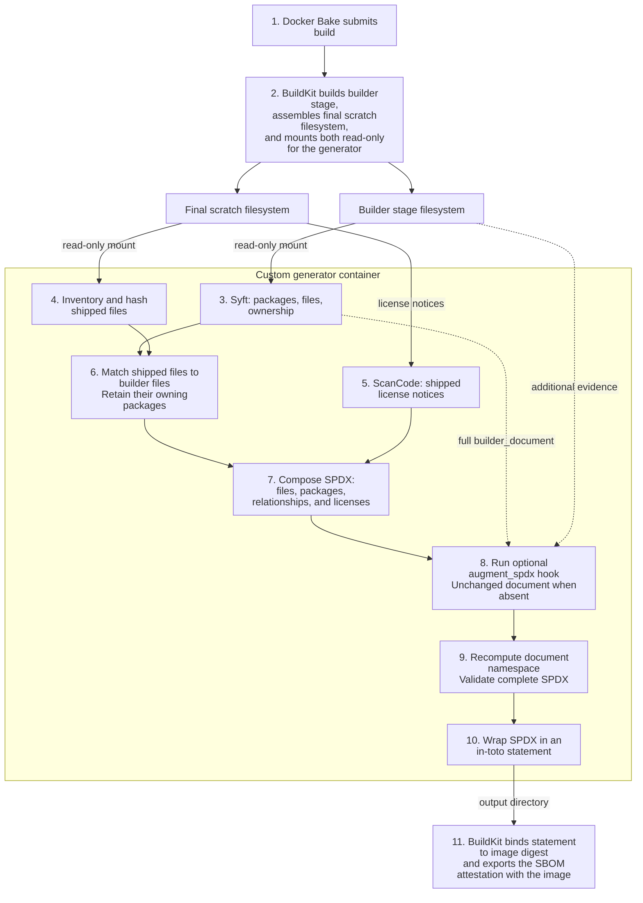

# SBOM generator

## Usage

When enabled, CloudNativePG extension images include an SPDX 2.3 software bill of materials (SBOM) for
each platform. It lists shipped files, their checksums, identifiable Debian
packages, and license evidence from the notices in `/licenses`, including copied
system libraries. Scan the PostgreSQL base image separately using its own SBOM.

### Verify the image and extract its SBOM

You need Cosign, Docker Buildx, Grype, and Grant. These examples use the
CloudNativePG PostGIS image built by this repository. Resolve its current index
digest so verification, extraction and reporting all use the same artifact:

```bash
REFERENCE=ghcr.io/cloudnative-pg/postgis-extension:3.6.4-18-bookworm
DIGEST=$(docker buildx imagetools inspect "$REFERENCE" --format '{{.Manifest.Digest}}')
IMAGE="ghcr.io/cloudnative-pg/postgis-extension@$DIGEST"

cosign verify "$IMAGE" \
  --certificate-identity='https://github.com/cloudnative-pg/postgres-extensions-containers/.github/workflows/bake_targets.yml@refs/heads/main' \
  --certificate-oidc-issuer='https://token.actions.githubusercontent.com'

docker buildx imagetools inspect "$IMAGE" \
  --format '{{ json (index .SBOM "linux/amd64").SPDX }}' \
  > postgis-amd64.spdx.json
```

Replace `linux/amd64` with `linux/arm64` and `postgis-amd64.spdx.json` with
`postgis-arm64.spdx.json` to inspect the ARM image. Extraction alone does not
verify the publisher. See [CloudNativePG's signature and attestation guidance](https://cloudnative-pg.io/docs/1.30/security/#image-signatures).

### Inspect and verify build provenance

BuildKit records build inputs and parameters alongside the SBOM:

```bash
docker buildx imagetools inspect "$IMAGE" \
  --format '{{ json (index .Provenance "linux/amd64").SLSA }}'
```

For extension images rebuilt after activation, separately signed SLSA provenance
identifies the source repository, commit, and workflow run. Verify that the image
was built from this project's `main` branch:

```bash
slsa-verifier verify-image "$IMAGE" \
  --source-uri github.com/cloudnative-pg/postgres-extensions-containers \
  --source-branch main
```

An image built from another branch fails verification with a message such as
`expected branch 'main', got 'work/sbom-validation'`. The command exits nonzero;
it does not silently accept a different branch. Testing and production images
both receive SLSA provenance. Mirrors must preserve its separate signed
attestation as well as the image index.

### Report vulnerabilities and licenses

```bash
grype sbom:postgis-amd64.spdx.json | grep -E 'NAME|High|Critical' | grep -v "won't fix"
grant list postgis-amd64.spdx.json
```

The filters show High and Critical findings except those marked "won't fix".
Omit the filters for the complete report; add `--only-fixed` to Grype to show only findings
with a known fix. Grant reports all package licenses.
To list packages associated with a license or inspect one package:

```bash
grant list postgis-amd64.spdx.json Qhull
grant list postgis-amd64.spdx.json Qhull --pkg libqhull-r8.0
```

See the [example output](../examples/sbom-reports.txt) from a CloudNativePG
PostGIS Bookworm validation build. These commands also accept SPDX extracted
from CloudNativePG PostgreSQL images. Scan the extracted SPDX: a direct filesystem scan of the scratch image
cannot recover its missing Debian package database. Findings depend on the
scanner's vulnerability database and supported package ecosystems.

#### Reading license results

Syft identifies packages in the builder, but is known to miss license declarations
for many Debian packages. We therefore use ScanCode to scan the shipped `/licenses`
notices. Its findings populate SPDX file records, contribute to their owning
packages' `licenseInfoFromFiles`, and fill missing or unknown `licenseDeclared`
values.

Grant reports package licenses. Unmatched files remain in SPDX with checksums and
scanned license evidence; their file-level findings may not appear in Grant's
package report. `NOASSERTION` means no value was established for that field.
`LicenseRef-*` identifiers refer to `hasExtractedLicensingInfos`, with ScanCode
reference text when available.

#### Retrieve an original notice

When ScanCode provides no reference text, the original notice is still shipped
in the image. Find its path in SPDX file records using `licenseInfoInFiles`.
For example, PostGIS's shipped notices contain an unidentified license reference:

```bash
jq -r '.files[] |
  select(any(.licenseInfoInFiles[]?;
    contains("LicenseRef-scancode-unknown-license-reference"))) |
  .fileName' postgis-amd64.spdx.json
# licenses/libde265-0/copyright
# licenses/libgfortran5/copyright
# licenses/libogdi4.1/copyright
# licenses/libquadmath0/copyright
# licenses/postgresql-18-postgis-3/copyright
```

Copy the PostGIS notice from a stopped container; no shell inside the scratch
image is needed:

```bash
CONTAINER=$(docker create --platform linux/amd64 "$IMAGE" /unused)
docker cp "$CONTAINER:/licenses/postgresql-18-postgis-3/copyright" ./postgis-copyright
docker rm "$CONTAINER"
```

Shared Debian notices can cover several libraries and produce broad license
expressions. Read the notice alongside the package and file evidence in SPDX.

## Development

### How it works



Files move when copied into the scratch image: for example,
`/usr/share/doc/gcc-12-base/copyright` becomes `/licenses/gcc-12-base/copyright`.
The generator matches shipped files to their original builder paths and checksums
to recover package ownership.

### Extension workflow activation

The extension workflow injects `ARG BUILDKIT_SBOM_SCAN_STAGE=builder` before the
Dockerfile's first `FROM` and selects `source: .` so Bake sees the modified checkout.
It pins the production generator image by digest. Extension Dockerfiles and the
scaffold do not need permanent scanner declarations.

This branch is blocked until the first checked, signed production generator image
is published from CloudNativePG's `main` and is publicly available in GHCR.
Replace `REPLACE_WITH_PRODUCTION_DIGEST` in `bake_targets.yml` with that verified
multi-platform digest before merging. A manual `:test` image is not a substitute.

Ordinary local builds retain the default scanner when `sbom_generator` is empty.
Local custom-generator builds also need the special stage argument declared in
the Dockerfile; passing only a build argument does not expose builder evidence.

### Add extension-specific inventory

To add components that the builder scan cannot identify, such as Rust crates,
Go modules, or Python distributions, install a Python file at
`/usr/local/share/cnpg-sbom/augment_spdx.py` in the extension's `builder` stage.
It must export `augment_spdx(document, context)` and return the updated SPDX
JSON dictionary. For example, copy your hook into the builder:

```dockerfile
COPY augment_spdx.py /usr/local/share/cnpg-sbom/augment_spdx.py
```

The hook runs after the generator composes the inventory and before SPDX
validation. Add package records, licenses, and relationships using normal SPDX
2.3 fields; see the [small fixture hook](tests/integration/fixture/augment_spdx.py)
for an example.

[The context](hooks.py) provides `api_version` (currently `1`), `extension_name`,
`platform`, `builder_path`, `final_path`, and the full Syft `builder_document`.
Treat that builder evidence as read-only; filesystem paths last only for this
invocation. The hook runs as trusted code inside the generator, using its Python
standard library and installed dependencies. Prepare any additional evidence as
files in the builder; the builder's own Python dependencies are not available.

Without a hook, the inventory is unchanged. Hook errors or invalid resulting
SPDX fail the build. Keep required license notices in the final image; adding a
package declaration does not copy notice files there.

### Generator release and test builds

`ghcr.io/cloudnative-pg/cnpg-sbom-generator:latest` identifies the checked generator
published from `main`; `:test` identifies the most recent checked manual test
publication. These are moving tags. Consumers pin a tag **and its image digest**,
so moving a tag does not silently change an extension build. `sha-<full-commit>`
tags retain individual builds; there are no major/minor releases.

#### Publication

| Trigger | Result |
| --- | --- |
| Pull request touching generator code/workflow | Checks only |
| Push to `main` touching `sbom-generator/**` | Publish or reuse commit image; promote the checked digest to `latest` |
| Workflow-only push to `main`, including Grype/Grant version bumps | Checks only |
| Manual dispatch, `publish=false` | Checks only |
| Manual dispatch, `publish=true` | Publish or reuse commit image; promote to `test` |

[The workflow](../.github/workflows/sbom-generator.yml) runs unit and
BuildKit/SPDX/Grype/Grant checks on native AMD64 and ARM64 runners, publishes a
two-platform image, verifies its platform configurations and source labels, and
smoke-tests the published digest on AMD64 before promotion. The generator image
includes per-platform BuildKit `mode=max` provenance and a default-scanner SPDX
SBOM. The publish job signs the checked image index with Cosign before promotion;
this binds the platform images and their attestations to the publishing workflow.
This does not provide `slsa-verifier` verification for the generator itself.

Publication is serialized. Failed checks leave aliases unchanged; manual
publication never moves `latest`. [release.py](release.py) reuses commit tags and
verifies alias digests. A dependency rebuild requires a new commit.

#### Testing from a branch

For example, push a generator change on a branch named `sbom-license-update`
and publish its test image:

```bash
git switch -c sbom-license-update
# Make and commit the generator change.
git push origin sbom-license-update

gh workflow run sbom-generator.yml \
  --repo cloudnative-pg/postgres-extensions-containers \
  --ref sbom-license-update -f publish=true

gh run list --repo cloudnative-pg/postgres-extensions-containers \
  --workflow sbom-generator.yml --branch sbom-license-update --limit 1
```

Take the checked `test@sha256:…` reference from the successful run summary and pin
it in a temporary consumer branch. Run the affected extension builds before
accepting the update. Keep test pins out of stable consumers.

#### Update consumers

When a generator change is merged to `main` and its checked publication advances
`latest`, [Renovate](../renovate.json) updates the stable `latest@sha256:…` consumer
pin. Review and merge consumer digest updates after the affected extension checks pass.

Renovate tracks the Python base-image digest, which covers its bundled Debian
packages and pip. Additional Debian packages are tracked in architecture-specific
`dependencies/debian-*.txt` files, grouped with that digest.
ScanCode dependencies follow the selected release's upstream pins, with ARM64
exceptions. ScanCode updates must pass both native AMD64 and ARM64 checks.

The Debian lists include build tools because those remain installed in the
generator image. New Debian dependencies must also be added to both lists.
The image revision label and SPDX creator identify the generator source commit.

To roll back, restore the previous checked consumer digest and hold updates until
fixed. Retain the corresponding commit images.
